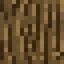
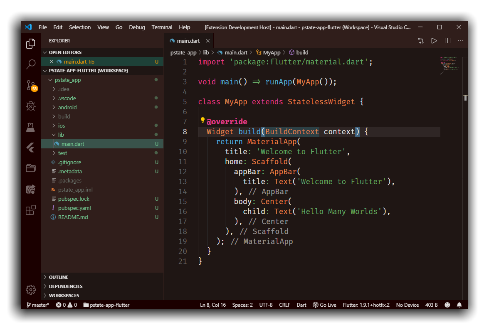
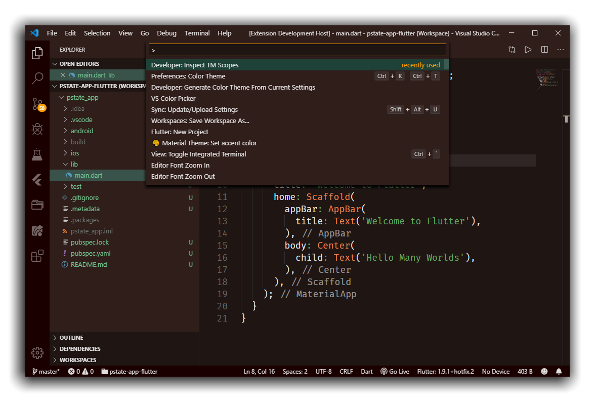
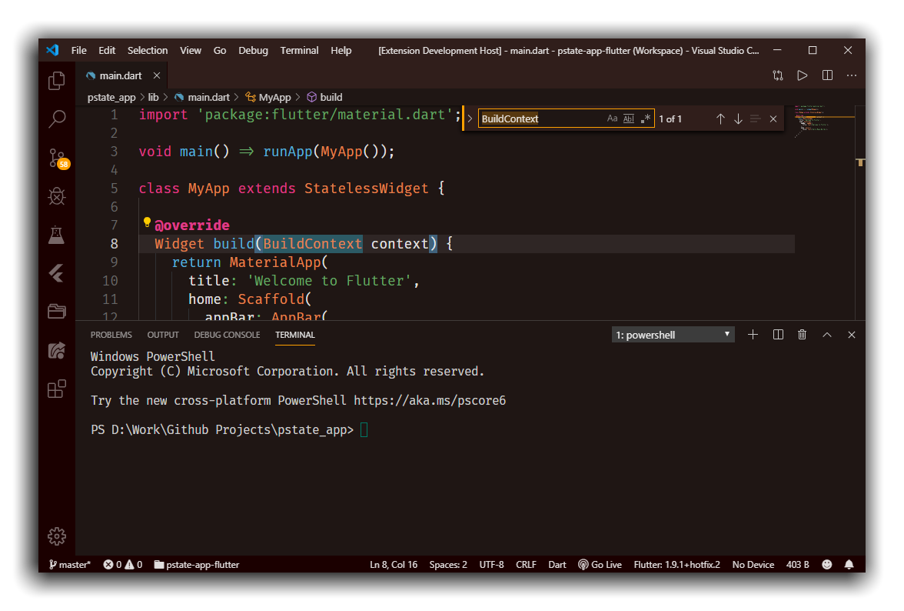
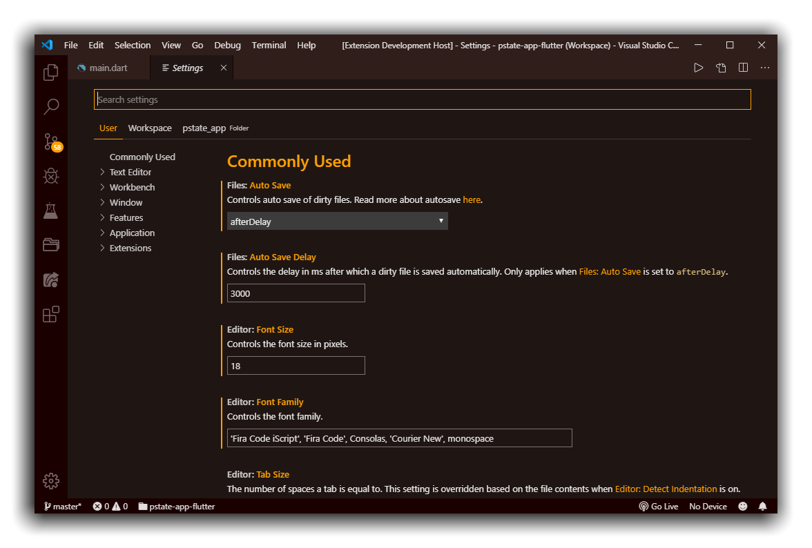

<p align="center">

</p>

<h1 align="center">Woody Theme</h1>

<p align="center">
A warm, dark colour theme for <a href="https://marketplace.visualstudio.com/items?itemName=seahyx.woody-theme" title="Link to marketplace">Visual Studio Code</a>.
</p>

<p align="center">
<a href="https://marketplace.visualstudio.com/items?itemName=seahyx.woody-theme"></a>
<a href="https://marketplace.visualstudio.com/items?itemName=seahyx.woody-theme"></a>
<a href="https://marketplace.visualstudio.com/items?itemName=seahyx.woody-theme&ssr=false#review-details"></a>
<br>
<a href="https://github.com/seahyx/Woody-Theme/releases/latest"></a>
<a href="https://github.com/seahyx/Woody-Theme/actions/workflows/ci.yml"></a>
<a href="https://github.com/semantic-release/semantic-release"></a>
<a href="https://github.com/seahyx/Woody-Theme/blob/master/LICENSE"></a>
</p>



## Nature right on your screen

Without the risk of venturing out into the cruel and dangerous outside world, you can enjoy the scenery of a dense forest right on your screen! Absolutely life-changing. Totally safe.



## It's brown,

> warm, and undoubtedly woody. With a tinge of amber and teal. Just like real wood. But it's not real wood so go out and see some real wood. Morning wood not included.

<p align="center">


<br>


<br>


</p>

Now, here's some more screenshots for your mindless consumption, because most people find reading an excruciatingly stressful task.



You may have noticed italics have been kept to a minimum. On certain fonts, I find them rather distracting. The different colours help to differentiate terms more comfortably to the eye.



## Install

Get it from the [Visual Studio Code Marketplace](https://marketplace.visualstudio.com/items?itemName=seahyx.woody-theme "Link to marketplace"), or from inside VS Code:

1. Open the Extensions view with <kbd>Ctrl</kbd>+<kbd>Shift</kbd>+<kbd>X</kbd> (<kbd>Cmd</kbd>+<kbd>Shift</kbd>+<kbd>X</kbd> on macOS).
2. Search for **Woody Theme** and select **Install**.
3. Open **Preferences: Color Theme** with <kbd>Ctrl</kbd>+<kbd>K</kbd> <kbd>Ctrl</kbd>+<kbd>T</kbd> (<kbd>Cmd</kbd>+<kbd>K</kbd> <kbd>Cmd</kbd>+<kbd>T</kbd> on macOS) and pick **Woody**.

Or from a terminal:

```sh
code --install-extension seahyx.woody-theme
```

Every [GitHub Release](https://github.com/seahyx/Woody-Theme/releases) also has the `.vsix` attached, which you can install offline with **Extensions: Install from VSIX...**.

## Improvements and Contribution

If you find any bugs (not real creepy crawlies scurrying about your dirty behind) or have any suggestions about new tree species or leaf colours to add to your favourite language, feel free to [open an issue on GitHub](https://github.com/seahyx/Woody-Theme/issues). I will be most welcome to new tree planters.

## Development

The theme file in `themes/` is generated, so don't edit it directly. Edit these sources instead:

| Source            | Contents                                                                        |
| ----------------- | ------------------------------------------------------------------------------- |
| `src/palette.mjs` | Every colour, named once. Change one here and it changes everywhere it is used. |
| `src/colors.mjs`  | Workbench (UI) colours.                                                         |
| `src/tokens.mjs`  | Syntax highlighting.                                                            |

The tools (Node.js and [prek](https://prek.j178.dev)) are pinned with [pixi](https://pixi.sh) and downloaded the first time a task runs. Install pixi, then use these commands:

| Command            | What it does                                                                                                                                             |
| ------------------ | -------------------------------------------------------------------------------------------------------------------------------------------------------- |
| `pixi run hooks`   | Sets up the git hooks. Run it once after cloning.                                                                                                        |
| `pixi run watch`   | Regenerates the theme on every save. Press <kbd>F5</kbd> to open an Extension Development Host, and the theme reloads every time you save a source file. |
| `pixi run build`   | Regenerates the theme once.                                                                                                                              |
| `pixi run package` | Builds the `.vsix`.                                                                                                                                      |
| `pixi run lint`    | Runs every hook on every file.                                                                                                                           |

If you already have Node.js, `npm run build` and `npm run watch` do the same thing, and `npm run package` works after `npm ci`. The npm packages are only release tooling. The extension itself has no dependencies.

### Commits and releases

Commit messages follow [Conventional Commits](https://www.conventionalcommits.org), and the commit hook rejects any that don't. The type decides the next version:

| Commit type                                        | Used for                          | Release |
| -------------------------------------------------- | --------------------------------- | ------- |
| `fix:`                                             | Colour corrections                | Patch   |
| `feat:`                                            | Newly themed UI or syntax         | Minor   |
| `feat!:`, or a `BREAKING CHANGE:` footer           | Something like a palette overhaul | Major   |
| `docs:`, `chore:`, `ci:`, `refactor:` and the like | Everything else                   | None    |

Releases are automatic. When a push to `master` contains a `fix`, `feat` or breaking change and the checks pass, [semantic-release](https://github.com/semantic-release/semantic-release) bumps the version and updates `CHANGELOG.md` in a `chore(release)` commit. It then tags the commit, publishes the extension to the Marketplace and creates a GitHub Release with the `.vsix` attached.

## More information

wOw, things that people may sometimes care about!

This is a personal project. I found a striking lack of warm colour themes on the extension market. I don't understand. Why would people put so much on their screen, when in the end night comes and they decide to put a blue-light filter on their screen anyway? And what's with some text with absolutely no contrast with the background? Are you trying to make art or write code?

I've based this off the Bear Theme ([Marketplace](https://marketplace.visualstudio.com/items?itemName=dahong.theme-bear "Visual Studio Code Marketplace") · [GitHub](https://github.com/shaodahong/theme-bear "GitHub Repository")). It is pretty heartwarming, like a bear hugging your face, but you know what it lacked? **Wood.** Plenty of wood. What's a bear doing in a cold, hard, place? It belongs in the forest, and that's what I gave it.

I was also inspired by the Slack Theme ([Marketplace](https://marketplace.visualstudio.com/items?itemName=felipe-mendes.slack-theme "Visual Studio Code Marketplace") · [GitHub](https://github.com/slack-theme/visual-studio-code "GitHub Repository")) (and their readme file), and I used it to decide where the colours should go. There are plenty of other additions on top of all that, to make sure that you don't lose the illusion of being in a beautiful, fake forest.

Otherwise, I would like to thank whoever made the Extension Generator Tool to help me create this masterpiece.

## License

[GPL-3.0](LICENSE)
